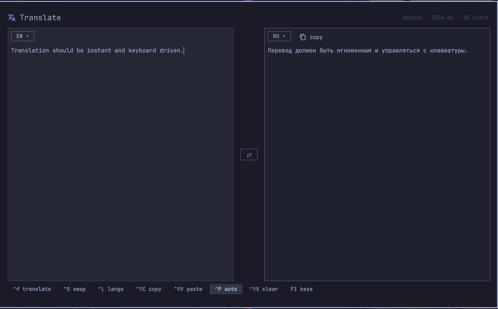

# Translate

Keyboard-first translation overlay for the Omarchy shell. Two panes, a language
chip per pane, a filterable language picker, and a free keyless backend.



## Keys

| Key | Action |
| --- | --- |
| `Super+Shift+K` | open / close the overlay |
| `Ctrl+Enter` | translate now |
| `Ctrl+S` | swap languages and panes (instant — the panes exchange text) |
| `Ctrl+L` | pick the source language |
| `Ctrl+Shift+L` | pick the target language |
| `Ctrl+1` / `Ctrl+2` | focus the source / translation pane (inside the picker: choose which side you are setting) |
| `Ctrl+Shift+C` | copy the translation |
| `Ctrl+Shift+V` | translate whatever is on the clipboard |
| `Ctrl+Shift+X` | clear both panes |
| `Ctrl+P` | toggle translate-while-typing |
| `Tab` / `Shift+Tab` | move focus between panes |
| `F1` | show the shortcut list |
| `Esc` | close the picker, then the overlay (cancels an in-flight request) |

In the language picker: type to filter (code, English name or native name),
`↑`/`↓` to choose, `Enter` to apply, `Tab` to switch between source and target,
`Esc` to cancel.

## Behaviour

- Default pair is English → Russian; the pair, the auto-translate switch, and
  the last panes persist in `~/.local/state/omarchy/translate.json`, so the
  overlay comes back the way you left it after a shell restart.
- With auto-translate on (the default), typing translates after 600 ms of
  quiet; `Ctrl+Enter` translates immediately, request per pause.
- Source `Auto` detects the input language and shows what it detected.
- `Esc` during a request aborts it instead of waiting for the endpoint.

## Backend

`Engines.js` translates from inside the shell process, over HTTPS, with
`XMLHttpRequest` — no helper program, no `curl`, no `jq`:

- the text never reaches a command line, so no other local user can read it out
  of `/proc/<pid>/cmdline`;
- it never touches the disk either, not even briefly in a temp file;
- the only way it leaves the machine is the HTTPS request to the engine that
  answers — everything else, like the copy shortcut putting the result on the
  clipboard, happens because you asked for it.

Engines, tried in order:

1. **google** — `clients5.google.com/translate_a/t?client=dict-chrome-ex`, the
   keyless endpoint the Chrome dictionary extension uses. Fast, good quality.
2. **mymemory** — `api.mymemory.translated.net/get`, keyless, ~5k characters/day
   anonymous.

Long text is chunked so no single request exceeds what an endpoint accepts, and
the chunks are rejoined on the newlines they were split on.

Knobs (environment):

| Variable | Effect |
| --- | --- |
| `OMARCHY_TRANSLATE_ENGINE` | `google` (default) or `mymemory` — which engine is tried first |
| `OMARCHY_TRANSLATE_EMAIL` | any address; raises MyMemory's anonymous daily quota |

Both come from the shell process's own environment, so export them before the
shell starts — or restart the shell after changing them.

## Layout

```
~/.config/omarchy/plugins/io.github.baltavay.translate/
  manifest.json          plugin manifest (kind: overlay, keepLoaded)
  Translate.qml          overlay: panes, picker, shortcuts, persistence
  Languages.js           language table (code, English name, native name)
  Engines.js             engine chain, chunking, request/response handling
  omarchy-menu.jsonc     menu row to merge into ~/.config/omarchy/extensions/
  preview.png
```

## Requirements

- Omarchy Quattro (`omarchy-shell` / Quickshell `PanelWindow` overlay).
- `wl-clipboard` (`wl-copy`, `wl-paste`) for the copy and paste shortcuts.
- Network access to `clients5.google.com` and/or `api.mymemory.translated.net`.
  No API keys, no accounts, nothing to configure.

## Install

From the marketplace listing, or straight from git:

```bash
omarchy plugin add https://github.com/baltavay/omarchy-translate.git --enable
```

That clones the repo into `~/.config/omarchy/plugins/io.github.baltavay.translate/`,
validates the manifest, and enables the overlay. Installing by hand instead:
check the folder, then add the id to `plugins[]` in `~/.config/omarchy/shell.json`
(the shell hot-reloads it) and add the keybinding to `~/.config/hypr/bindings.lua`:

```bash
omarchy plugin validate ~/.config/omarchy/plugins/io.github.baltavay.translate
```

```lua
o.bind("SUPER + SHIFT + K", "Translate", "omarchy-shell shell toggle io.github.baltavay.translate")
hl.layer_rule({ match = { namespace = "^omarchy-translate$" }, no_anim = true, animation = "none" })
```

The plugin ships no keybinding and no menu row of its own — it never edits your
config. Add the lines above (plus the `trigger.translate` row from
`omarchy-menu.jsonc` if you want it in the Omarchy menu) to make it yours.
`Super+Shift+K` is free on stock Omarchy (`Super+K` is keybindings, `Super+Alt+K`
tmux, `Super+Ctrl+K` herdr). `omarchy-shell shell toggle io.github.baltavay.translate` is
the same thing from a terminal.

The overlay is also summonable with a payload:

```bash
omarchy-shell shell toggle io.github.baltavay.translate '{"text":"Good morning","source":"en","target":"ru"}'
omarchy-shell shell toggle io.github.baltavay.translate '{"source":"auto","target":"ru"}'
omarchy-shell shell summon io.github.baltavay.translate '{"clipboard":true}'
```

`{"clipboard":true}` translates whatever is on the clipboard, read by the
plugin itself, so the text never rides on a command line the way `"text"`
does. The read waits ~120 ms for the app that owns the selection to finish
answering the copy that summoned it. It is ignored while the overlay is already
open: the overlay holds the keyboard then, so the summon can only have come
from a copy inside the overlay. Use `summon` rather than `toggle` here.

### Translate on double copy

Pressing the copy shortcut twice in quick succession (DeepL-style `Ctrl+C+C`)
can open the overlay on what you just copied. Hyprland's Lua config can count
the presses itself, so a single copy spawns nothing. In
`~/.config/hypr/bindings.lua`:

```lua
local function double_tap(action, window_ms)
  local armed, seq = 0, 0
  return function()
    if armed ~= 0 then
      armed = 0
      action()
      return
    end
    seq = seq + 1
    local mine = seq
    armed = mine
    hl.timer(function()
      if armed == mine then armed = 0 end
    end, { timeout = window_ms, type = "oneshot" })
  end
end

local function translate_clipboard()
  hl.exec_cmd([[omarchy-shell -q shell summon io.github.baltavay.translate '{"clipboard":true}']])
end

local function active_window_is_terminal()
  local window = hl.get_active_window()
  for _, tag in ipairs(window and window.tags or {}) do
    if tag:gsub("%*$", "") == "terminal" then return true end
  end
  return false
end

-- Super+C, C: added next to Omarchy's universal copy, not instead of it.
o.bind("SUPER + C", "Translate on double copy", double_tap(translate_clipboard, 400))

-- Ctrl+C, C: non_consuming so the app still copies. Skipped in terminals,
-- where Ctrl+C is SIGINT and a double one often means "quit".
local ctrl_c_tap = double_tap(translate_clipboard, 400)
o.bind("CTRL + C", "Translate on double copy", function()
  if not active_window_is_terminal() then ctrl_c_tap() end
end, { non_consuming = true })
```

Each combination gets its own counter, so the synthetic `Ctrl+C` that universal
copy sends never pairs with a `Super+C` into a false double press.

## Removal

```bash
omarchy plugin disable io.github.baltavay.translate   # or: remove the id from shell.json plugins[]
omarchy plugin remove  io.github.baltavay.translate
rm ~/.local/state/omarchy/translate.json              # the remembered language pair
```

Then drop the `o.bind(...)` line and the `hl.layer_rule(...)` line from
`~/.config/hypr/bindings.lua`, and the `trigger.translate` row from
`~/.config/omarchy/extensions/omarchy-menu.jsonc` if you merged it. Nothing else
outside `~/.config/omarchy/plugins/<id>/` is touched.
